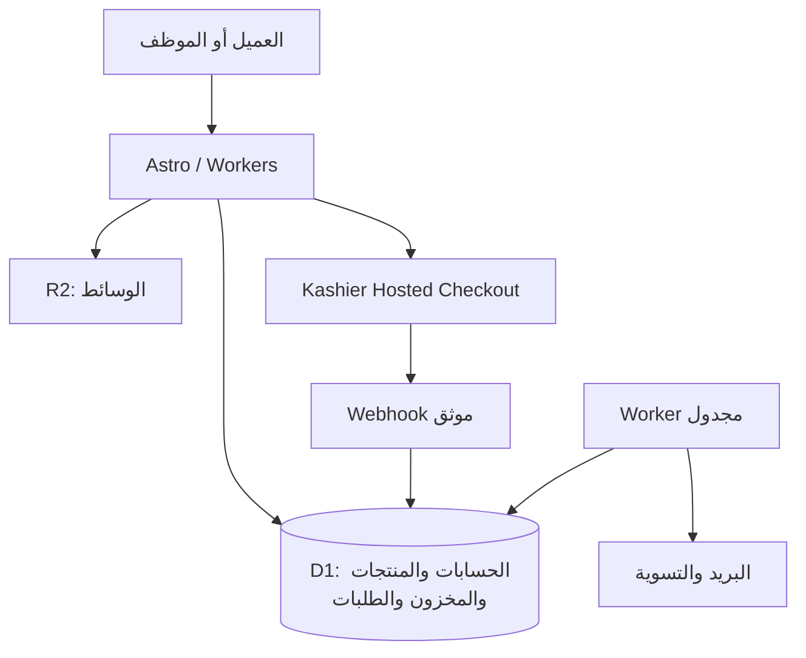

# خطة تنفيذ تيراز — من الهوية إلى متجر قابل للتشغيل

الإصدار 1.0 — 17 أكتوبر 2026. الحالة: **خطة تنفيذ؛ التطبيق الحالي ما زال معاينة**.

هذه الوثيقة تحول اختيارات صاحب المشروع إلى نطاق عمل وتسليمات واختبارات وشروط إطلاق. كتابة الخطة لا تعني إنشاء الخدمات أو شراء اشتراكات أو اعتماد المتجر للإنتاج. المرجع العام: [الدليل الهندسي](ENGINEERING-GUIDELINES.md)، والتحقق النهائي: [قائمة الإطلاق](LAUNCH-CHECKLIST.md).

## 1. النتيجة المطلوبة

متجر مخصص بالكامل لبيع السجاد الحرير اليدوي الفاخر في مصر، بهوية **تيراز / Tiraze** على **tiraze.net**، يعمل بالعربية والإنجليزية، ويقبل الطلبات والدفع الأونلاين من أول إطلاق. يستطيع فريق صغير إدارة المنتجات والمخزون والطلبات والتحصيل والشحن دون تعديل الكود.

الجودة تقاس بصحة المال والمخزون، ووضوح تجربة العميل، وسهولة صيانة الكود، وسرعة اكتشاف الأعطال واستعادة التشغيل. كثرة الخدمات أو نتيجة Lighthouse وحدها لا تثبت الجاهزية.

## 2. القرارات المعتمدة وحدود الافتراضات

| الموضوع | القرار المعتمد من صاحب المشروع |
|---|---|
| البراند | تيراز، وليس طيراز؛ الإنجليزية Tiraze |
| التصميم | الحفاظ على التصميم المختار وهوية الكحلي والعاجي والذهبي، والهيرو فيديو |
| المنصة | متجر مخصص: واجهة وخلفية ولوحة إدارة؛ الخدمات السحابية المُدارة مقبولة |
| السوق | مصر أولًا، بكيان وحساب بنكي مصريين، والعملة EGP |
| الكتالوج | الاستعداد لـ100–1000 سجادة/تصميم، ببيانات ومخزون حقيقيين |
| البيع | شراء مباشر للمخزون الجاهز + طلب عروض للتفصيل |
| الحسابات | التسجيل وتسجيل الدخول مطلوبان قبل الشراء |
| الدفع | كاشير Kashier + الدفع عند الاستلام |
| الدفع عند الاستلام | إجمالي الطلب حتى 10,000 جنيه، بتأكيد موظف قبل التجهيز |
| الشحن | حساب تلقائي وفق المنطقة وحجم/وزن الطرد، وحجز يدوي مع شركة الشحن |
| التكلفة | البدء بالمجاني والأقل تكلفة؛ لا اشتراك مدفوع مفعّل بموجب هذه الخطة |

**افتراضات الخطة القابلة للتعديل:** تحقق البريد قبل إتمام الشراء، حجز أونلاين 15 دقيقة، مهلة تأكيد COD حتى 24 ساعة، وطرد مستقل لكل سجادة في حساب الشحن الأولي. هذه إعدادات مقترحة، وليست سياسات تجارية سبق اعتمادها. تُحسم في المرحلة صفر قبل تشغيل البيع.

حالة حساب كاشير وتفعيل وسائل الدفع والعقود والأسعار والضرائب وسياسات الاسترجاع لم تُثبت بعد. اختيار المزود لا يعني وجود حساب إنتاج مفعل. الترشيح التقني أدناه يحتاج نموذج إثبات؛ الموافقة على اتجاه المتجر المخصص لا تعني الموافقة على شراء خدمة بعينها.

## 3. ما سنحافظ عليه وما سنبنيه

الموجود: واجهة HTML/CSS/JS، هوية ثنائية اللغة، ثلاثة تصورات سجاد، سلة ومفضلة محليتان، وفيديو هيرو واختبارات عرض. لا توجد بعد تجارة إنتاج أو حسابات أو قاعدة طلبات أو دفع حقيقي. تفاصيل الواقع في [خط الأساس](ENGINEERING-BASELINE.md).

نحافظ على إيقاع التصميم والمساحات والخطوط والألوان والتفاعل والفيديو الأصلي مع الإيقاف والتشغيل واحترام تقليل الحركة. تُراجع حقوق الوسائط وجودتها قبل النشر. تبقى ملفات IRTH الأصلية والمشروع الشقيق دون تعديل. لا تتحول التصورات الثلاثة إلى منتجات متاحة للبيع دون بيانات معتمدة.

نبني طبقة تجارة جديدة، ثم ننقل الواجهة إليها تدريجيًا. نجمع CSS المتراكم في نظام واضح، ونفصل الدوال الكبيرة، ونحول الصفحات إلى HTML قابل للفهرسة. لا ننقل تعقيد المعاينة كما هو إلى الإطار الجديد.

## 4. المعمارية المرشحة

**الترشيح: Astro + TypeScript على Cloudflare Workers، مع D1 وR2.** السبب هو قربه من الواجهة الحالية واعتماده على HTML مع JavaScript عند الحاجة، وإمكان جمع الخلفية والواجهة في تطبيق واحد بتشغيل قليل التكلفة. هذه توصية هندسية مشروطة بالمرحلة صفر، وليست ادعاء بأن أي إطار آخر غير صالح. يدعم Cloudflare تشغيل Astro كتطبيق كامل بخدمات خلفية. [التوثيق الرسمي](https://developers.cloudflare.com/workers/framework-guides/web-apps/astro/)

| الطبقة | الاختيار المقترح | المسؤولية |
|---|---|---|
| الواجهة | Astro، وReact islands حيث يلزم | صفحات المتجر، السلة، الحساب، ولوحة الإدارة |
| الكود | TypeScript strict، pnpm workspace | عقود واضحة وحزم مشتركة محدودة |
| الخلفية | Workers، تطبيق معياري واحد | التسعير، المخزون، الطلبات، الصلاحيات والتكاملات |
| قاعدة البيانات | D1 + Drizzle ومراجعة SQL | السجل الدائم ومصدر الحقيقة التجاري |
| الوسائط | R2 + نطاق وسائط | الصور والفيديو ومشتقاتهما؛ الرفع الخاص منفصل عن النشر |
| الحسابات | Better Auth | جلسات وحسابات وتحقق بريد واستعادة وTOTP للإدارة |
| الدفع | Kashier Hosted Checkout | إنشاء جلسة دفع من الخادم والتحقق والتسوية |
| البريد | Resend | تحقق الحساب والطلبات وتحديثاتها، عبر outbox دائم |
| المهام | Worker مجدول + D1 outbox | إعادة المحاولة، انتهاء الحجوزات، التسوية والإشعارات |
| المصدر والجودة | GitHub + Actions | مراجعة وتحقق وبناء ونشر مضبوط |

تكامل Better Auth مع Astro وD1 وDrizzle موثق، لكن توافق الإصدارات واستهلاك تشفير كلمات المرور في Workers يجب إثباتهما عمليًا. لا نضع مصادقة ضعيفة لتناسب حصة مجانية. [Astro](https://better-auth.com/docs/integrations/astro)، [قاعدة البيانات](https://better-auth.com/docs/concepts/database)، [Drizzle](https://better-auth.com/docs/adapters/drizzle)، [المصادقة الثنائية](https://better-auth.com/docs/plugins/2fa)



لا خدمات مصغرة أو Redis أو Kubernetes عند البداية. وحدات التجارة منفصلة داخل الكود، لكن العملية التجارية لا تتوزع بين عدة قواعد بيانات. إذا فشل إثبات D1 أو المصادقة تحت الحمل المطلوب، نصدر ADR بديلًا قبل استكمال البناء؛ لا نغير القاعدة بعد بناء المتجر كله.

## 5. خطة التكلفة

الأسعار والحدود أدناه مرجع بتاريخ إعداد الخطة، وتراجع قبل التفعيل. لا يوجد وعد بتشغيل متجر تجاري كامل مجانًا مهما كان الاستخدام.

| الخدمة | نقطة البداية | شرط المراجعة أو الترقية |
|---|---|---|
| التطوير | محلي ومحاكيات Cloudflare وحسابات sandbox | دون تحصيل فعلي أو موارد مدفوعة |
| Workers | تجربة Free: 100 ألف طلب ديناميكي/يوم و10ms CPU للاستدعاء | قياس SSR والمصادقة؛ اقتراح Paid عند الإنتاج يبدأ من 5 دولارات/شهر للحساب، مع استخدام زائد |
| D1 | Free ضمن 5M صف قراءة و100k كتابة يوميًا و5GB إجمالي | مراجعة حجم كل قاعدة وحدود الاستعلامات والذروة والفهارس |
| R2 Standard | الحصة المجانية: 10GB-month، و1M Class A و10M Class B شهريًا | جرد الفيديو والصور والنسخ والطلبات؛ مراجعة الفوترة قبل التفعيل |
| Resend | Free: 3000 رسالة شهريًا و100 يوميًا | التسجيل والتحقق يستهلكان الحصة؛ ترقية قبل وصول النمو إلى الحد |
| GitHub | حفظ المصدر والتحقق ضمن حصة الحساب | مراجعة دقائق CI والتخزين؛ لا تحفظ بيانات العملاء أو الأسرار |

مصادر الحدود: [Workers](https://developers.cloudflare.com/workers/platform/pricing/)، [D1](https://developers.cloudflare.com/d1/platform/pricing/)، [R2](https://developers.cloudflare.com/r2/pricing/)، [Resend](https://resend.com/pricing). تقديم Static Assets مباشرة يقلل طلبات Worker، لكن الطلب الديناميكي والحساب والدفع يحتاجون ميزانية محسوبة.

GitHub Pages غير مناسب لهذا المتجر وفق حدود استخدامه للتجارة الإلكترونية. Google Cloud يظل بديلًا للتقييم، لكن حصص Cloud Run المجانية لا تجعل قاعدة البيانات وباقي التشغيل مجانية تلقائيًا؛ لذلك لا نجمع مزودين كثيرين لمجرد وجود حصص مجانية متفرقة. [GitHub Pages](https://docs.github.com/en/pages/getting-started-with-github-pages/github-pages-limits)، [Cloud Run](https://cloud.google.com/run/pricing)، [Cloud SQL trial](https://docs.cloud.google.com/sql/docs/postgres/free-trial-instance)

قبل الإطلاق ننتج ورقة تكلفة: زيارات وطلبات ديناميكية، قراءة/كتابة قاعدة البيانات، حجم وسائط، رسائل يومية، رسوم كاشير، شحن، دومين ونسخ احتياطي. نختبر ثلاثة سيناريوهات: بداية هادئة، نمو متوقع، وحملة بزيادة عشرة أضعاف. تنبيهات عند 50% و80% من الحصص، وحدود CPU والرفع والطلبات العامة، مع تقرير شهري. تنبيه الميزانية لا يعد سقف فوترة مضمونًا. لا تفعّل الخطة أي اشتراك الآن.

## 6. هيكل المستودع المقترح

```text
apps/
  web/src/
    pages/               # ar, en, api, admin
    components/          # واجهة فقط
    layouts/
    styles/              # tokens, base, components
    server/              # ربط HTTP بالوحدات والصلاحيات
  jobs/src/              # cron، outbox، التسوية
packages/
  core/src/              # money, catalog, inventory, orders, payments, shipping
  db/                    # schema, migrations, repositories
  contracts/             # مخططات الإدخال والإخراج والتحقق
tests/
  unit/
  integration/
  e2e/
docs/
  decisions/
  runbooks/
```

تطبيقان للنشر: المتجر والمهام، يشتركان في نفس وحدات الأعمال. لا حزمة لكل دالة. لا تستورد الواجهة مفاتيح الخادم. نثبت إصدارات مدعومة وقت التنفيذ وlockfile وإصدار Node وأداة البناء، ونفعل lint وtypecheck وformat. قواعد المال والمخزون مستقلة عن صفحات Astro حتى يمكن اختبارها أو نقل الاستضافة دون إعادة كتابة التجارة.

## 7. تجربة العميل والصفحات

| المساحة | المحتوى والسلوك المطلوب |
|---|---|
| الرئيسية | فيديو الهيرو، دعوة للمجموعة، قطع مختارة، الحرفة، الثقة والخدمة دون ادعاءات غير مثبتة |
| الكتالوج | تصفية بالمقاس واللون والسعر والمتاح، فرز، صفحات نتائج وعناوين URL قابلة للمشاركة |
| المنتج | صور حقيقية وزوم ومقاسات وخامة وتقنية ومنشأ موثق وعناية وتوفر وسعر وشحن وسياسة إرجاع |
| السلة | تعديل الكمية وحذف، تقدير شحن، إظهار تغيّر السعر أو نفاد قطعة قبل المتابعة |
| الحساب | تسجيل وتحقق واستعادة، عناوين، طلبات وتفاصيلها وتتبع آمن |
| Checkout | حساب مسجل، عنوان مصري، سعر شحن نهائي، وسيلة دفع ومراجعة إجمالي |
| نتيجة الدفع | قيد التحقق/تم الدفع/فشل؛ لا تعلن النجاح من query string |
| التفصيل | نموذج طلب عرض، رقم مرجعي وتأكيد استلام ومتابعة موظف |
| المحتوى | قصة تيراز، الحرفة، دليل المقاسات، العناية، تواصل، سياسات معتمدة |

المسارات `/ar/...` و`/en/...`، مع توجيه واضح للجذر. الروابط القديمة لها خريطة تحويل 301 عندما تتغير؛ المنتج المحذوف لا يعود صفحة 200 وهمية. تبديل اللغة يحتفظ بالمنتج والسلة قدر الإمكان. السعر بالعملة المصرية في اللغتين.

التصفح والسلة الأولية متاحان دون حساب. عند الشراء يُطلب الدخول مع حفظ السلة والوجهة، ثم دمجها بقواعد محددة ومنع تكرار الكميات. المتصفح يخزن معرفات واختيارات فقط؛ الخادم يعيد تسعير كل شيء. لا تنشر السلة المحلية القديمة كطلبات حقيقية.

نراجع التصميم بصور مقارنة فعلية عند 320 و390 و768 و1440px، مع RTL/LTR ولوحة مفاتيح وقارئ شاشة. تحويل الووردمارك إلى ملف متجهي إنتاجي بدقة وحقوق خط واضحة مهمة ضمن تأسيس الهوية، مع الحفاظ على الشكل المعتمد.

## 8. البيانات والكتالوج

| المجموعة | البيانات الأساسية |
|---|---|
| Product / translation | عنوان ووصف عربي/إنجليزي، slug، حالة draft/published/archived، فئة وسمات |
| SKU / media | مقاس فعلي، خامة موثقة، قطعة فريدة أو كمية، وزن وأبعاد طرد، صور وترتيب وalt |
| Price | مبلغ صحيح بالقروش، EGP، طريقة الضريبة المعتمدة؛ لا floating point للأموال |
| Inventory / ledger | موجود فعلي، محجوز، حركات بسبب ومرجع ومنفذ، قيود تمنع السالب |
| Customer / address | هوية الحساب، البريد، الهاتف المصري، عنوان توصيل؛ صلاحيات ملكية لكل طلب |
| Cart / quote | عناصر وإصدار للسلة، وطلبات تفصيل مستقلة عن أوامر البيع |
| Order / line snapshot | سعر وخامة ومقاس وعنوان ورسوم وسياسة بتاريخ الطلب، لا بيانات قابلة للتغير لاحقًا |
| Reservation | SKU وكمية وطلب وانتهاء وحالة؛ تحويل أو تحرير مرة واحدة |
| Payment attempt / inbox | مزود، مرجع، مبلغ وعملة، حالة، أحداث موثقة ومعرّف منع التكرار |
| Refund / shipment | مبلغ وسبب ومرجع المزود، شركة شحن وتتبع وتسليم وتحصيل |
| Operations | outbox، محاولات مهام، audit log، إصدارات أسعار شحن، idempotency keys |

لكل قطعة فريدة SKU مستقل بكمية واحدة. التصميم ذو المقاسات المتعددة يحتوي SKUs فعلية؛ الصور لا تثبت وجود مخزون. تُحفظ التواريخ UTC وتعرض بتوقيت القاهرة. القيود والفهارس تشمل SKU، slugs لكل لغة، مرجع كاشير، ومفاتيح منع التكرار، واستعلامات الحجز والطلبات والمهام.

استيراد CSV حتى 1000 منتج: قالب موثق، dry run وتقرير أخطاء صفية، كشف SKU مكرر، تحقق من السعر والصور والوزن، ثم نشر دفعات قابلة للتتبع. لا ينشر صف ناقص. يجرّب الاستيراد أولًا بـ20 منتجًا حقيقيًا ثم الحجم الكامل. البحث يبدأ بفلاتر وفهارس D1؛ لا محرك بحث مستقل قبل قياس الحاجة، وتختبر مطابقة العربية والإنجليزية صراحة.

## 9. صحة المخزون والطلبات

قاعدة البيانات هي الحكم الوحيد. فحص التوفر ثم الحجز في طلبين منفصلين غير كافٍ. يتم إنشاء الطلب والحجوزات وتحديث المخزون في عملية ذرية، مع شرط توفر وقيد يرفض المخزون السالب. تدعم D1 تنفيذ `batch` كمعاملة تتراجع عند خطأ SQL؛ لا نفترض دعم معاملة تفاعلية مفتوحة بين اتصالات الشبكة. [D1 batch](https://developers.cloudflare.com/d1/worker-api/d1-database/)

تُثبت آلية SQL قبل اعتمادها: إذا تعذر العنصر الثاني في طلب متعدد العناصر، يجب التراجع عن حجز الأول والطلب كله. فحص نتائج الصفوف بعد اكتمال batch لا يصنع rollback؛ يلزم فشل داخل المعاملة عند عدم كفاية المخزون، بقيد أو trigger مصمم ومختبر. لا يحل كاش أو قفل متصفح هذا الشرط.

نفصل ثلاثة محاور للحالة:

| المحور | أمثلة للحالات |
|---|---|
| الطلب | awaiting_payment، pending_cod_review، confirmed، cancelled، completed |
| الدفع | unpaid، pending، paid، failed، refund_pending، partially_refunded، refunded، paid_unallocated |
| التنفيذ | unfulfilled، preparing، shipped، delivered، returned |

لا يؤدي webhook متأخر بفشل إلى إلغاء دفع ناجح. لا يؤدي نجاح دفع إلى اعتبار الطلب مشحونًا. كل انتقال له قواعد وصلاحية وسجل، وكل حركة مخزون قابلة للمراجعة. حالة الاسترجاع لا تعيد المخزون للبيع قبل فحص القطعة المرتجعة واعتمادها.

## 10. تكامل كاشير

1. يتحقق الخادم من الحساب والعنوان والتوفر ويحسب السعر والشحن والإجمالي، ثم ينشئ طلبًا وحجزًا ومفتاح منع تكرار.
2. ينشئ محاولة دفع دائمة، ثم جلسة Kashier من الخادم، ويعيد رابط Hosted Checkout المعتمد. لا تمر بيانات البطاقة على خوادم تيراز. [إنشاء جلسة](https://developers.kashier.io/docs/api-reference/payment-sessions/createPaymentSession)
3. إذا انقطع الاتصال بعد إرسال إنشاء الجلسة، تصبح المحاولة غير محسومة وتُستعلم قبل السماح بمحاولة أخرى؛ لا نفترض أن فشل الشبكة يعني فشل الدفع. لا انتقال آلي لبوابة ثانية.
4. تستقبل نقطة webhook الحدث وتتحقق من توقيعه، وتسجله في inbox دائم، ثم تعالجه مرة واحدة. المطابقة تشمل مرجع الطلب والتاجر والوضع والمبلغ والعملة والحالة، مع مطابقة معرّفات العملية.
5. يُنفذ توقيع Payment Webhook وفق توثيق كاشير تحديدًا: `signatureKeys` وترتيبها وترميز قيمها وHMAC SHA-256 ومفتاح Payment API ومقارنة ثابتة الزمن. لا نستخدم خوارزمية مزود آخر أو توقيع payout. لا تعني كلمة event وحدها نجاح الدفع. [توثيق webhook](https://developers.kashier.io/docs/webhooks)
6. يُقر الاستلام بعد الحفظ الدائم؛ تكرار الحدث لا يكرر الخصم أو الطلب أو البريد. فشل الحفظ يظل قابلًا لإعادة الإرسال. صفحة العودة تعرض حالة الخادم وتستعلم لفترة محدودة.
7. مهمة تسوية تستعلم عن المحاولات العالقة، وتراجع المدفوعات مقابل الطلبات يوميًا. مفاتيح test/live منفصلة ولا تظهر في المصدر أو السجلات. [الإطلاق](https://developers.kashier.io/docs/get-started/going-live)

عند انتهاء الحجز لا يتم حذفه دون أثر؛ تحرره مهمة ذرية قابلة للتكرار. إذا وصل دفع صحيح متأخرًا، يحاول النظام تخصيص المخزون ذريًا من جديد؛ إن نفد تصبح الحالة `paid_unallocated` مع تنبيه ومنع التجهيز ومسار استرجاع مسؤول. لا نعد العميل بقطعة بيعت لغيره.

قبل البيع نختبر البطاقة والمحفظة إن كانت مفعلة بالحساب، والفشل والإلغاء والتأخر والتكرار والاسترجاع الكامل والجزئي ضمن قدرات العقد. الاسترجاع من لوحة الموظف يحتاج تحقق صلاحية وإعادة مصادقة ومفتاح منع تكرار ومرجع ومتابعة حتى تأكيد المزود؛ زر الضغط لا يساوي نجاح الاسترجاع. رسوم البوابة والتسوية والاعتراضات من عقد التاجر، ولا نختلق نسبًا.

## 11. الدفع عند الاستلام والشحن

حد COD يطبق خلفيًا على **الإجمالي النهائي شامل الشحن وأي رسوم** حتى 1,000,000 قرش، أو الحد الأقل في عقد الناقل. ما يزيد عن الحد يتاح له الأونلاين فقط. لا يستطيع العميل تجاوز الشرط بتعديل API.

الطلب يبدأ `pending_cod_review` وحجز محدود المهلة. الموظف يؤكد الهاتف والعنوان وقيمة التحصيل ثم يؤكد الطلب أو يرفضه بسبب مسجل. عند انتهاء مهلة المراجعة المقترحة 24 ساعة يُلغى الحجز ويخطر العميل؛ التمديد المحدود فعل صريح مسجل. تأكيد الموظف لا يحول الدفع إلى paid. التسليم والتحصيل وتسوية الناقل مراحل منفصلة، ولا نعتبر تحصيل الموظف النقدي أو تسوية الناقل تلقائيًا.

الشحن: جدول معتمد للمحافظة/المنطقة وفئة وزن وحجم الطرد. الافتراض الأول: حساب كل سجادة كطرد وجمع الرسوم؛ الجمع في طرد واحد مؤجل حتى توثيق قواعد الناقل. تُحفظ نسخة التسعير في الطلب. منطقة غير مغطاة أو طرد بلا تسعير يمنع checkout ويوجه للتواصل، دون مبلغ تخميني أو طلب مدفوع ناقص الشحن.

الموظف يحجز يدويًا، ويسجل الناقل ورقم التتبع والرابط من قائمة نطاقات مسموحة وتاريخ الشحن، فيخطر العميل. لكل تأخير أو رفض استلام أو إرجاع إجراء مكتوب. لا إرسال آلي لبيانات العميل إلى شركة شحن قبل إعداد العقد والتكامل المصرح به.

## 12. التفصيل ولوحة الإدارة

طلب التفصيل يحفظ المقاس واللون والخامة المطلوبة والميزانية الاختيارية ووسيلة التواصل والملاحظات، برقم مرجعي وحالات new/contacted/quoted/closed. لا تسعير آلي ولا تحصيل عربون في الإصدار الأول. المرفقات إن لزمت خاصة، مع حدود عدد وحجم وأنواع وفحص؛ يمكن إطلاق النموذج دون مرفقات لتقليل النطاق.

| الدور | الصلاحيات الأساسية |
|---|---|
| Owner | المستخدمون والإعدادات والأدوار واعتماد الإجراءات الحساسة |
| Catalog | المنتجات والصور والاستيراد؛ لا أسرار دفع أو استرجاع مالي |
| Fulfillment | تأكيد COD والتجهيز والشحن والتتبع وفق السياسة |
| Support | الاطلاع المقيد ومتابعة الطلب والعرض؛ لا تعديل مبلغ مدفوع |
| Finance | مطابقة التحصيل وتنفيذ الاسترجاع والتقارير المالية |

يمكن لصاحب المشروع جمع أدوار في حساب واحد، لكن المنع يطبق على الخادم. حسابات موظفين منفصلة وTOTP إلزامي ونسخ استرداد محفوظة بأمان؛ لا حساب إدارة مشترك. العمليات الحساسة تسجل: المنفذ والوقت والفعل والسبب والمرجع، مع تجنب تخزين أسرار أو بيانات شخصية زائدة في سجل التدقيق.

اللوحة تشمل بحث الطلبات وفلاترها، تفاصيل محفوظة، سجل أحداث، تحذيرات دفع، تعديل مخزون بسبب، إدارة مناطق الشحن، محتوى ثنائي اللغة، قائمة عروض التفصيل، وإعادة إرسال آمنة للإشعار. لا نبدأ بمحرر صفحات عام أو ERP أو CRM كامل.

## 13. الأمان والخصوصية

العقود الأساسية: `/api/auth/*` للحسابات، و`/api/cart` للسلة، و`/api/checkout` لإنشاء الطلب، و`/api/orders/:id` لطلب مالكه، و`/api/payments/kashier/webhook` للأحداث، و`/api/quote-requests` للتفصيل، و`/api/admin/*` للإدارة. كل إدخال له schema وحد حجم، وكل خطأ له رمز ثابت ورسالة مترجمة وrequest ID دون stack أو أسرار. الطلبات المالية المغيرة للحالة تقبل idempotency key مرتبطًا بصاحب الطلب وhash المدخلات؛ إعادة المفتاح بمدخل مختلف ترفض، وإعادته بنفس المدخل تعيد نتيجة العملية دون أثر ثانٍ. تحدد مدة الاحتفاظ وفق نافذة إعادة المحاولة والمراجعة المالية. مواصفات العقود تُكتب قبل ربط الواجهة، وتراجع صلاحية كل endpoint على الخادم.

نكتب threat model لمسارات الحساب وامتلاك الطلب والسعر والمخزون وwebhook ورفع الملفات والإدارة. تستخدم متطلبات OWASP ASVS المناسبة كقائمة تحقق، دون ادعاء شهادة امتثال. [OWASP ASVS](https://owasp.org/www-project-application-security-verification-standard/)

- تحقق مخطط الإدخال على الخادم، واستعلامات ممررة المعلمات، وإخراج آمن دون HTML غير موثوق.
- Cookies للجلسة HttpOnly وSecure وسياسة SameSite مناسبة، وإبطال جلسات وتدوير عند تغييرات حساسة وحماية CSRF وفحص Origin للعمليات المغيرة للحالة.
- حدود طلبات ومسارات مختلفة للتسجيل والدخول والاستعادة والاستفسار والcheckout؛ Turnstile عند الحاجة يتحقق منه الخادم، ولا يحل محل الصلاحيات.
- عدم كشف وجود بريد في استعادة الحساب، وروابط محدودة الصلاحية والاستخدام، وعدم تسجيل كلمات مرور أو tokens.
- فحص ملكية الطلب والعنوان في كل endpoint؛ إخفاء الزر ليس تحكم وصول.
- أسرار لكل بيئة في مخزن المزود، أقل صلاحيات، ومنع مفاتيح الإنتاج في previews وCI غير الموثوق.
- CSP مبنية على نطاقات التكامل الفعلية وتختبر في checkout، ورؤوس حماية دون كسر كاشير؛ لا HSTS preload تلقائيًا قبل جاهزية النطاقات.
- R2 خاص افتراضيًا للوثائق والمرفقات، صور عامة معتمدة فقط، أسماء عشوائية وفحص محتوى وحدود رفع وعدم تشغيل الملفات المرفوعة.
- منع تسرب البريد والهاتف والعنوان وبيانات جلسة الدفع إلى analytics والسجلات؛ مدة احتفاظ وحذف وصلاحيات تصدير موثقة.
- اعتماد السياسات والفواتير والضرائب والحقوق مع المختصين بحسب الكيان والنشاط؛ لا نفترض نسبة ضريبة أو مدة قانونية من ملف مرجعي.

## 14. الأداء والإتاحة والفهرسة

الصفحات العامة SSR أو prerender بحسب المحتوى، والمحتوى المنتج موجود في HTML الأول. لا كاش مشترك للحساب والسلة والcheckout والإدارة وwebhooks؛ تستخدم `no-store` مع اختبارات عدم تسرب جلسة. كاش الكتالوج قصير أو مبطل عند التعديل، والتوفر النهائي يعاد فحصه عند الشراء دائمًا.

صور متعددة المقاسات AVIF/WebP مع بديل وأبعاد محددة، تحميل كسول أسفل الصفحة، خطوط قليلة محلية مرخصة، وJavaScript للتفاعل فقط. ميزانية أولية: JS أولي للصفحات العامة أقل من 150KB gzip، CSS أقل من 60KB gzip، وposter للهِيرو أقل من 250KB، وتعدل بقرار موثق إذا أثبت القياس حاجة. فيديو الهيرو نسخة ويب مضغوطة مع poster؛ يبدأ بعد أولوية المحتوى، يحترم تقليل الحركة ووضع توفير البيانات حيث يتاح، ويبقى التحكم اليدوي متاحًا. لا يحمل أصل الفيديو الضخم لكل زائر.

الهدف الميداني عند توفر بيانات كافية: LCP ≤2.5s وINP ≤200ms وCLS ≤0.1 عند p75، مع اختبار شبكة وجهاز متوسطين قبل الإطلاق. لا تساوي النتيجة المعملية نجاح القياس الميداني. [Core Web Vitals](https://web.dev/articles/vitals)

إتاحة مستهدفة WCAG 2.2 AA: تباين وتركيز وتسميات وأخطاء مفهومة وتصفح لوحة مفاتيح وزوم وتحكم بالحركة وفيديو بلا صوت تلقائي. تختبر يدويًا وآليًا، ولا تعني أداة واحدة المطابقة الكاملة. [WCAG 2.2](https://www.w3.org/TR/WCAG22/)

SEO: canonical وhreflang وsitemap وrobots وOpen Graph، وProduct/Offer ببيانات سعر وتوفر حقيقية، دون مراجعات أو تقييمات مختلقة. بيئة staging محمية وغير مفهرسة. analytics قليل البيانات، بأحداث view_item/add_to_cart/begin_checkout/purchase؛ purchase لا يسجل مرتين ولا من redirect غير موثق. الموافقات التسويقية وسياسة ملفات الارتباط تعتمد قبل تفعيل أدواتها.

## 15. التشغيل والنسخ والاستعادة

البيئات local/staging/production منفصلة في قواعد البيانات والوسائط والأسرار وكاشير. migrations مراجعة ومختبرة على نسخة ممثلة؛ التغييرات غير المتوافقة تمر expand/migrate/contract. الرجوع للكود لا يرجع مخطط قاعدة البيانات تلقائيًا.

Outbox داخل نفس معاملة الحدث التجاري، يقرأه Worker مجدول بمهام لها قفل بمهلة ومحاولات محدودة وbackoff وdead-letter. فشل البريد لا يمحو الطلب. لا ترسل المهمة مرتين بسبب تشغيل متزامن. حالة إرسال مجهولة تتطلب تسوية أو مفتاح مزود إن توفر بدل التكرار الأعمى.

المراقبة: أخطاء التطبيق، زمن API، 5xx، فشل كاشير والتوقيع، دفع دون تخصيص، حجوزات متأخرة، طابور بريد وdead-letter، فجوات تحصيل COD، وفشل النسخ. لكل تنبيه مالك وقناة وإجراء؛ يختبر وصول تنبيه فعلي قبل الإطلاق. هدف تشغيل داخلي أولي 99.9% شهريًا مع قياس واستجابة، وليس ضمان SLA تعاقديًا.

النسخ: استخدام D1 Time Travel ضمن حدود الخطة، مع تصدير يومي مشفر إلى bucket خاص مستقل، ونسخة دورية خارج حساب الإنتاج. تحفظ مفاتيح التشفير خارج النسخة. الوسائط الأصلية لها نسخة مستقلة ومراقبة سلامة؛ Git ليس نسخة احتياطية لبيانات العملاء، ونسخة في نفس الحساب وحدها لا تغطي فقد الحساب. [حدود D1 والاستعادة](https://developers.cloudflare.com/d1/platform/limits/)

أهداف أولية تُثبت بتجربة: RPO لقاعدة الطلبات حتى 15 دقيقة داخل نافذة استعادة المزود، RPO لفقد الحساب كاملًا حتى 24 ساعة وفق وتيرة النسخة الخارجية، وRTO حتى 4 ساعات. تصدير يومي وحده لا يحقق RPO ربع ساعة. نختبر الاستعادة في بيئة منفصلة مع إعادة مطابقة كاشير ومنع إعادة الإشعارات أو الشحن بعد الاستعادة. أي هدف لم يثبت لا يعلن كقدرة مكتملة.

تكتب runbooks: تعطل checkout، دفع معلق، webhook متكرر، مخزون غير متطابق، استرجاع، تعطل بريد، طلب COD، فقد صلاحية موظف، تسرب سر، وفشل مزود/استعادة. عند تعطل الدفع يتوقف إنشاء محاولات جديدة بأمان وتظل الطلبات السابقة قابلة للتسوية، دون فقد سجلها.

## 16. مراحل التنفيذ والاعتماد

التقدير **30–48 يوم عمل هندسي تقريبًا، أي 6–10 أسابيع** لمهندس متفرغ مع مشاركة صاحب المشروع واختبار جودة مستمر. ليس موعدًا ملزمًا؛ تأخر المحتوى والتعاقد وتفعيل كاشير ومراجعة السياسات يؤخر الإطلاق. مراجعة النطاق بعد مرحلة الإثبات واجبة قبل تثبيت الجدول.

| المرحلة | المدة التقديرية | التسليم | شرط الخروج |
|---|---|---|---|
| P0: إثبات واختيارات | 2–3 أيام | نموذج Astro/Workers، مخطط مال ومخزون، ورقة تكلفة وقرارات | نجاح معاملة متعددة العناصر والتزامن، مصادقة آمنة ضمن الخطة، اتصال sandbox كاشير |
| P1: تأسيس | 3–5 أيام | هيكل الكود، CI، migrations، بيئات، sessions وأدوار | build/typecheck ولوجين واستعادة وتحقق بريد وعزل حسابات واختبار TOTP |
| P2: هوية وكتالوج | 5–8 أيام | صفحات عربية/إنجليزية، فيديو، منتجات وفلاتر واستيراد | مقارنة بصرية، 1000 سجل تجريبي، HTML وSEO وإتاحة وفهارس |
| P3: تجارة ودفع | 6–9 أيام | سلة خادم، تسعير، حجز، checkout، كاشير وCOD | عدم تكرار الطلب/الدفع، حدود COD، تسوية وتأخر واسترجاع ناجح |
| P4: إدارة وتشغيل | 5–8 أيام | إدارة مخزون وطلبات وشحن وتفصيل وبريد وتقارير | تنفيذ دورة طلب كاملة بواسطة موظف دون تعديل كود |
| P5: تقوية وإطلاق | 6–10 أيام | أمان وحمل واستعادة وUAT ومراقبة وتجربة محدودة | إغلاق بوابات الإطلاق بالدليل وتفعيل بيانات وعقود إنتاج |
| احتياطي | 3–5 أيام | إصلاحات التكامل والحواف | تحديث المخاطر والجدول وفق النتائج |

الأمن والاختبارات والمراقبة جزء من كل مرحلة؛ P5 تحقق نهائي، وليس أول مرة نختبر فيها الدفع. يبدأ تجهيز المنتجات وعقد كاشير والشحن والسياسات بالتوازي من P0.

## 17. Backlog قابل للتنفيذ

كل البنود أدناه **مخطط لها، وليست مكتملة**. لكل بند منفذ ومراجع ودليل قبول عند التنفيذ.

| ID | العمل | يعتمد على | دليل القبول |
|---|---|---|---|
| T01 | إثبات Workers/Astro والمصادقة والتكلفة | — | قياس CPU وزمن وقاعدة ومصفوفة حدود |
| T02 | إثبات حجز D1 الذري | — | اختبار آخر قطعة + rollback طلب متعدد العناصر |
| T03 | تجربة Kashier sandbox | — | إنشاء واستعلام وwebhook موثق وفشل معروف |
| T04 | تثبيت مخطط البيانات وقيودها | T02,T03 | migrations وفهارس واختبارات invariants |
| T05 | CI وبيئات وأسرار | T01 | فحص pull request وعزل staging |
| T06 | حسابات وTOTP وأدوار | T04,T05 | اختبارات جلسات وملكية وصلاحيات |
| T07 | نقل الهوية والفيديو واللغتين | T05 | صور مقارنة واختبار حركة وتحكم |
| T08 | كتالوج وإدارة منتجات واستيراد | T04,T07 | dry run، أخطاء صفوف، 1000 سجل |
| T09 | سلة ومطابقة أسعار وشحن | T06,T08 | دمج سلة وقيم خلفية ومناطق غير مغطاة |
| T10 | طلبات وحجوزات وCOD | T09,T02 | منع سالب وحد مالي وتأكيد وانتهاء |
| T11 | كاشير وinbox وتسوية | T10,T03 | أحداث مكررة ومتأخرة ومبالغ خاطئة واسترجاع |
| T12 | outbox وبريد وتنبيهات | T05,T10 | فشل وإعادة محاولة دون تكرار أثر |
| T13 | إدارة شحن وتحصيل وتقارير | T10,T11 | دورة موظف من التأكيد للتسوية |
| T14 | نموذج تفصيل ومتابعة | T06,T08 | طلب دائم وإشعار وصلاحيات وصول |
| T15 | SEO وأداء وإتاحة وخصوصية | T07–T14 | تقارير فعلية ومراجعة يدوية |
| T16 | نسخ واستعادة وأمان وحمل | T04–T14 | استعادة مستقلة وتنبيهات واختبارات ضغط |
| T17 | تدريب وUAT وبيانات إنتاج | T13–T16 | قبول صاحب المشروع وقائمة تشغيل |
| T18 | تجربة محدودة ثم إطلاق | T17 | دفع إنتاج مضبوط وتسوية وشحن ومراقبة |

## 18. الاختبارات الحاسمة

| المجال | الحالات التي يجب إثباتها |
|---|---|
| المال | حساب صحيح بالقروش، حدود وrounding، تغيير سعر بعد السلة، عدم قبول سعر العميل |
| المخزون | 100 محاولة متزامنة لقطعة واحدة: حجز واحد فقط؛ فشل ثاني عنصر يرجع الأول؛ تحرير متكرر آمن |
| كاشير | توقيع خاطئ، مفاتيح test/live، مبلغ/عملة/تاجر خاطئ، تكرار وعكس ترتيب وتأخر أحداث |
| الشبكة | انقطاع بعد إنشاء الجلسة، نتيجة غير معروفة، تكرار checkout، إغلاق المتصفح أثناء الدفع |
| الحجز | ساعة اختبار، انتهاء أثناء الدفع، وصول نجاح بعد نفاد القطعة، تمديد COD وتأكيد متزامن مع الانتهاء |
| الاسترجاع | كامل وجزئي ومنع الزيادة عن المدفوع وتكرار الطلب وفشل المزود ثم تسوية |
| الحسابات | اختطاف رابط طلب، CSRF، صلاحيات موظف، استعادة وتحقق بريد وTOTP وإبطال جلسة |
| التشغيل | بريد معطل، مهمة متداخلة، dead-letter، تنبيه، تصدير واستعادة دون إعادة شحن |
| الواجهة | رحلة شراء عربية وإنجليزية، موبايل Safari وChrome وEdge، 320px، فيديو وreduced motion |
| الحمل | 1000 منتج، ذروة مبنية على توقعات فعلية، مؤقتًا 100 جلسة متزامنة مع checkout محدود في staging |

وحدات لقواعد المال والحالات، وتكامل على D1 الحقيقي في staging والمحاكي محليًا، وE2E للمسارات الحرجة. لا يكفي mock لقاعدة البيانات لإثبات الذرية. اختبارات الحمل لا تُرسل مدفوعات حقيقية أو آلاف الرسائل. تقارير المعاينة السابقة تبقى أدلة عرض فقط ولا تعاد تسميتها اختبارات تجارة.

## 19. مدخلات صاحب المشروع بالتوازي

- بيانات الكيان والعنوان وخدمة العملاء والحساب البنكي، وحالة عقد كاشير وتفعيل وسائل الدفع والتسوية؛ المفاتيح تدخل في مخزن أسرار آمن، لا في الشات أو Git.
- ملف منتجات حقيقي: SKU، سعر، كمية، مقاسات، خامة، منشأ موثق، صور وحقوق استخدامها، وزن وأبعاد تغليف.
- عقد شركة الشحن ومناطق التغطية والتسعير وحد التحصيل ومسؤولية التلف والتأمين ورفض الاستلام.
- سياسات البيع والشحن والإرجاع والخصوصية ومحتوى الفواتير مع المراجعة المختصة، وفصل سياسة التفصيل عن الجاهز.
- موظفو الإدارة وصلاحياتهم وأوقات تأكيد COD والتعامل مع التنبيهات، وبريد إرسال موثق ووسيلة دعم منشورة.
- اعتماد الإعدادات المقترحة للحجز والتحقق والشحن، وميزانية التشغيل عند طلب تفعيل موارد الإنتاج.

غياب هذه المدخلات لا يمنع بناء sandbox، لكنه يمنع إطلاق بيع حقيقي بمعلومات مختلقة.

## 20. بوابات الإطلاق والتدرج

1. **Preview:** الشكل والوظائف ببيانات اختبار، دون تحصيل أو فهرسة staging.
2. **Staging مكتمل:** 20 منتجًا حقيقيًا للمراجعة، ثم اختبار حجم الكتالوج الكامل؛ دورة شراء sandbox وإدارة وشحن واسترجاع ونسخ.
3. **جاهزية إنتاج:** حساب كاشير وعقود وسياسات ووسائط وموظفون ومراقبة ونسخ موثقة، وتكلفة معتمدة قبل أي تفعيل مدفوع.
4. **Pilot مضبوط:** تجربة إنتاج قليلة وبمبالغ مدروسة بمشاركة صاحب المشروع، مع التحقق من ظهور التحصيل والتسوية والاسترجاع والشحن فعليًا.
5. **إطلاق عام:** لا أخطاء حرجة في المال أو المخزون أو الصلاحيات، واختبارات القبول ناجحة وتدريب مكتمل وrunbooks معروفة. تراجع [قائمة الإطلاق](LAUNCH-CHECKLIST.md) بالدليل، لا بمجرد وجود هذه الخطة.

خلال فترة التثبيت الأولى يراجع الفريق يوميًا الدفع العالق وCOD والحجوزات ورسائل البريد وأخطاء العميل والتسوية. أي نشر جديد يمر CI وstaging مع اختبارات المسارات المتأثرة. تنفيذ الخطة لاحقًا لا يجيز تلقائيًا تفعيل فوترة أو نشر إنتاج دون تفويض مناسب.

## 21. ما بعد الإصدار الأول

مخاطر المسار الرئيسية: اكتمال المصادقة ضمن CPU المستهدف، وصحة معاملات الحجز في D1، وتفعيل كاشير، وسعة البريد وقت الحملات، وجودة بيانات 1000 منتج، وتوفر موظف COD. تعالج الثلاثة الأولى في P0، ويجهز المحتوى والعقود بالتوازي، ويحدد بديل وتقنية وتكلفة بقرار واضح إذا فشل الإثبات. لا يستمر البناء فوق مشكلة مالية أو أمنية معروفة لمجرد الالتزام بموعد.

مؤجل: تطبيقات iOS/Android أصلية، أسواق وعملات إضافية، دفع عروض التفصيل والعربون، BNPL، ولاء ونقاط، محرك توصيات، مراجعات عملاء، تسويق آلي موسع، ربط ناقل API، ERP وخدمات مصغرة. أي إضافة تمر قيمة تجارية وتكلفة وتشغيل واختبار، ولا تؤخر صحة تجربة الشراء الأساسية.

مسار التوسع: تحسين الاستعلامات والصور أولًا، ثم ترقية الحصص وفق القياس، ثم فصل البحث أو المهام الثقيلة عند الحاجة. تجهز exports ومخطط بيانات موثق ونسخ وسائط لتقليل الارتهان للمزود. نجاح البداية يعني القدرة على استقبال طلب صحيح ودفع موثق وتسليم معروف واسترجاع قابل للمراجعة، بكود يستطيع الفريق فهمه وتشغيله.
